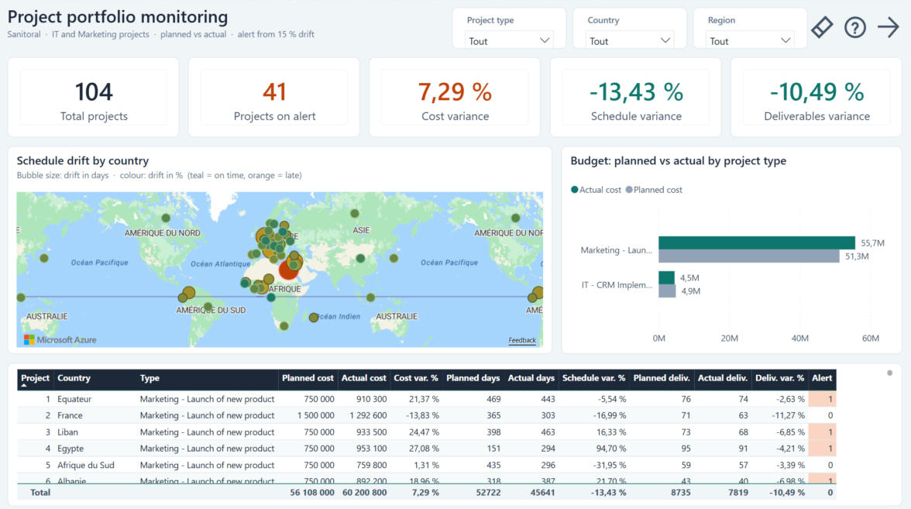
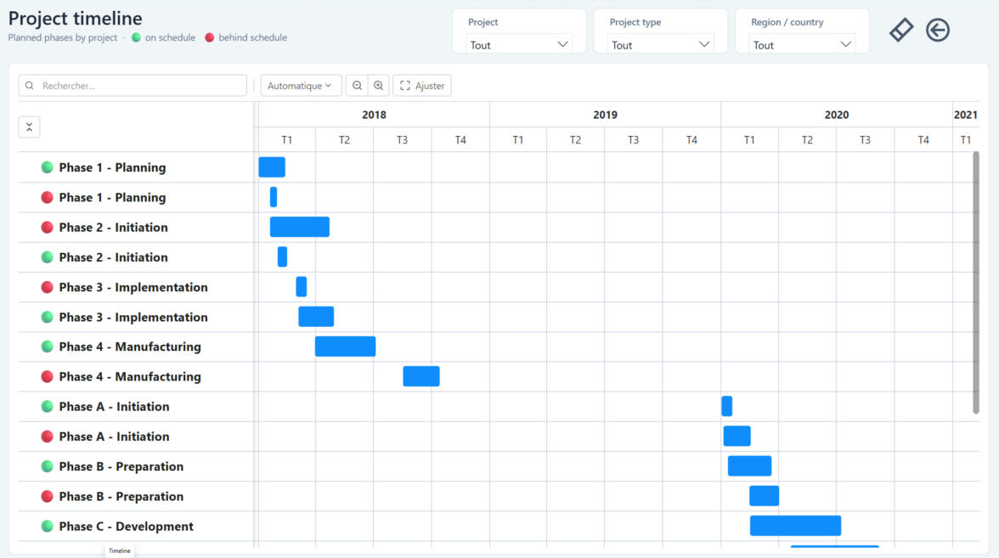
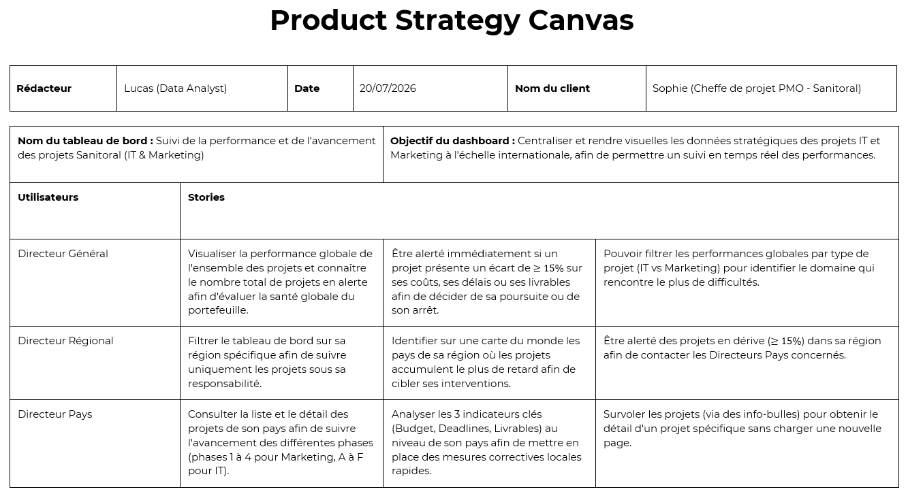
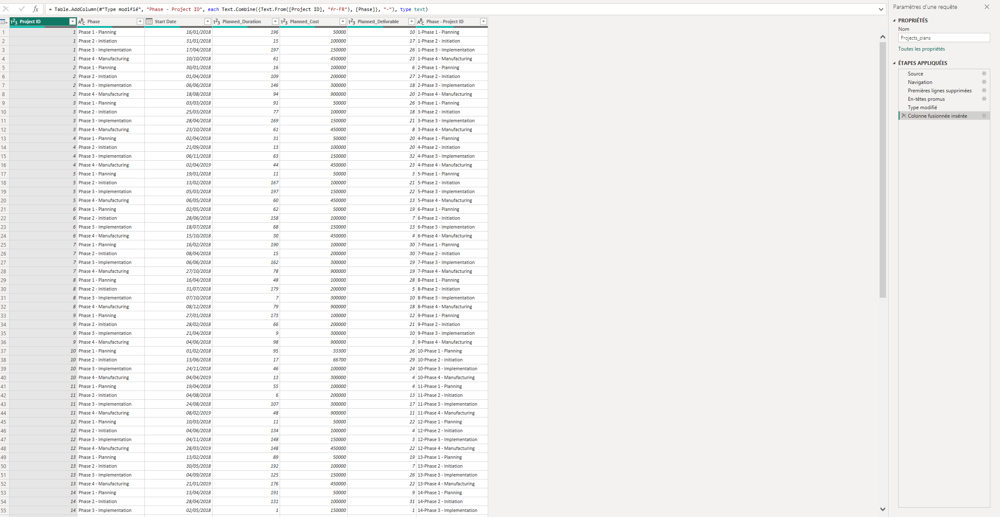
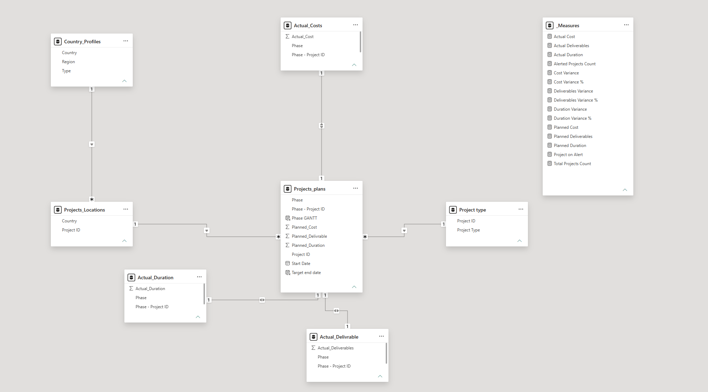

[Français](README.md) | **English**

# Global Project Portfolio Monitoring & Variance Analytics (Power BI)

## At a glance

An interactive Power BI dashboard for Sanitoral, an international organisation running IT and Marketing project portfolios in parallel across several countries. The goal: centralise performance tracking, automate data refresh, and let three levels of management (executive, regional, country) drill down into the results.

- **Tools:** Power BI, Power Query (M), DAX
- **Deliverables:** Power BI report in English and French, star schema data model, documented DAX measures

---

## Dashboard preview

**Overview**: the five key indicators, schedule drift by country, planned vs actual budget by project type, and project-level detail (projects on alert are highlighted).

**Timeline**: Gantt chart of each project's phases, with a 🟢 on schedule / 🔴 behind schedule flag.

---

## Framing & user stories

The dashboard was scoped around the needs of three management personas:
- **CEO / General Management:** overall portfolio health, active vs. delayed projects, overall budget drift, filtering by domain (IT or Marketing).
- **Regional Directors:** geographic distribution on a map, regional delay bottlenecks, local intervention triggers.
- **Country Managers:** detailed phase-level tracking (Phases 1–4 for Marketing, A–F for IT), KPI variances, interactive tooltips for each project.

---

## Automated data preparation (Power Query)

- **No manual preprocessing:** cleaning and shaping are done entirely in Power Query M code.
- **Composite keys:** a unique `[Phase - Project ID]` key built by merging columns, linking baseline plans to actual records without altering the raw files.
- **Repeatable refresh:** transformation steps handle recurring updates with no loss of data integrity.

---

## Data model

A star schema designed for fast calculations and clear filter propagation:
- **Central fact table (plan):** `Projects_plans`
- **Fact tables (actuals):** `Actual_Costs`, `Actual_Duration`, `Actual_Deliverable`
- **Dimension tables:** `Country_Profiles`, `Projects_Locations`, `Project type`
- **Dedicated measure table:** `_Measures`, holding all DAX calculations

---

## DAX measures & governance

All measures are grouped and documented in [`dax_measures.md`](./dax_measures.md).

- **Variance tracking:** planned vs. actual cost, duration and deliverables, in absolute values and percentages.
- **Automated alerts:** a project is flagged as soon as it drifts by 15% or more on budget, deadlines or deliverables.
- **User experience:** custom Gantt chart, natural language Q&A and contextual tooltips.

---

## Repository contents

| File | Description |
|---|---|
| `Sanitoral-Project_Monitoring_en.pbix` | Interactive Power BI report (English) |
| `Sanitoral-Project_Monitoring_fr.pbix` | Interactive Power BI report (French) |
| `theme/SanitoralPortfolio.json` | Power BI report theme (colours, typography, cards) |
| `dashboard_*.png` | Dashboard screenshots (EN and FR) |
| `dax_measures.md` | Documented DAX measures |
| `project_strategy_canvas.png` | Business requirements and user stories |
| `data_model_en.png` | Star schema data model |
| `etl_steps.png` | Power Query preparation steps |
| `README.md` / `README.en.md` | Documentation in French / English |

---

Project completed as part of the OpenClassrooms Data Analyst program.
