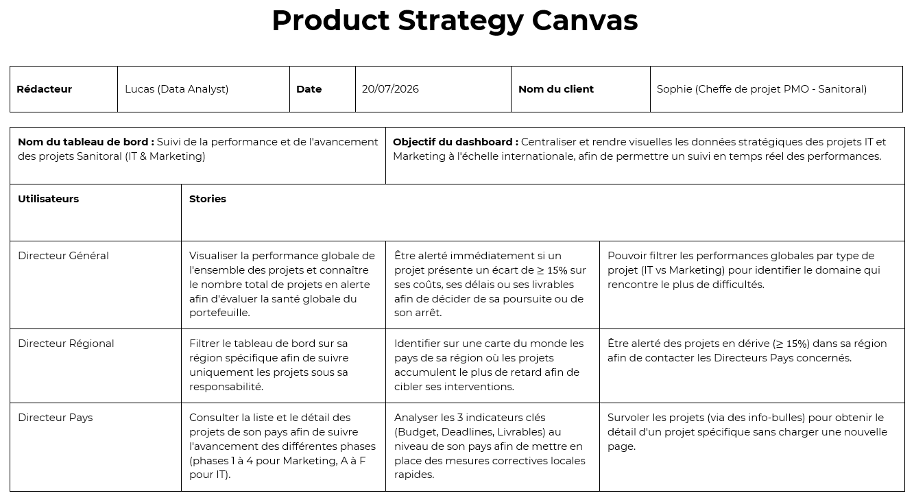
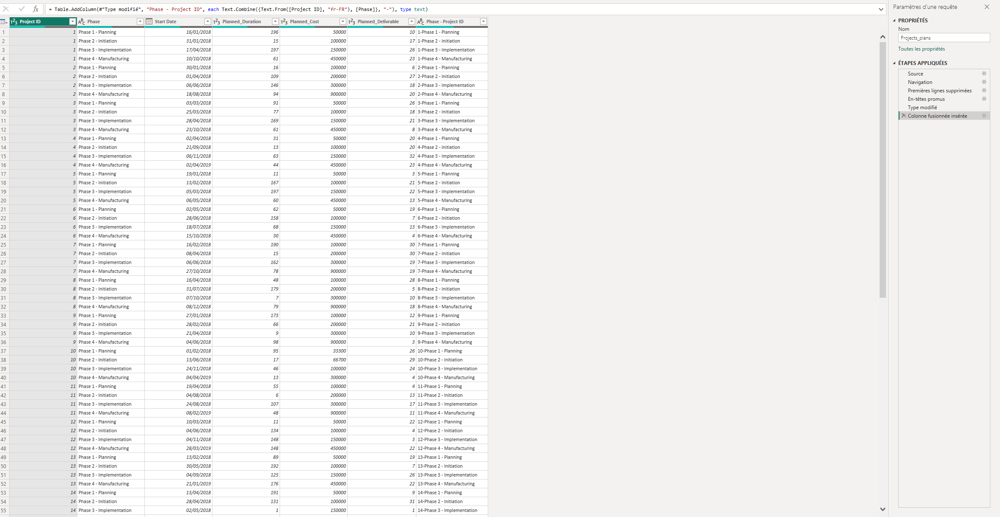
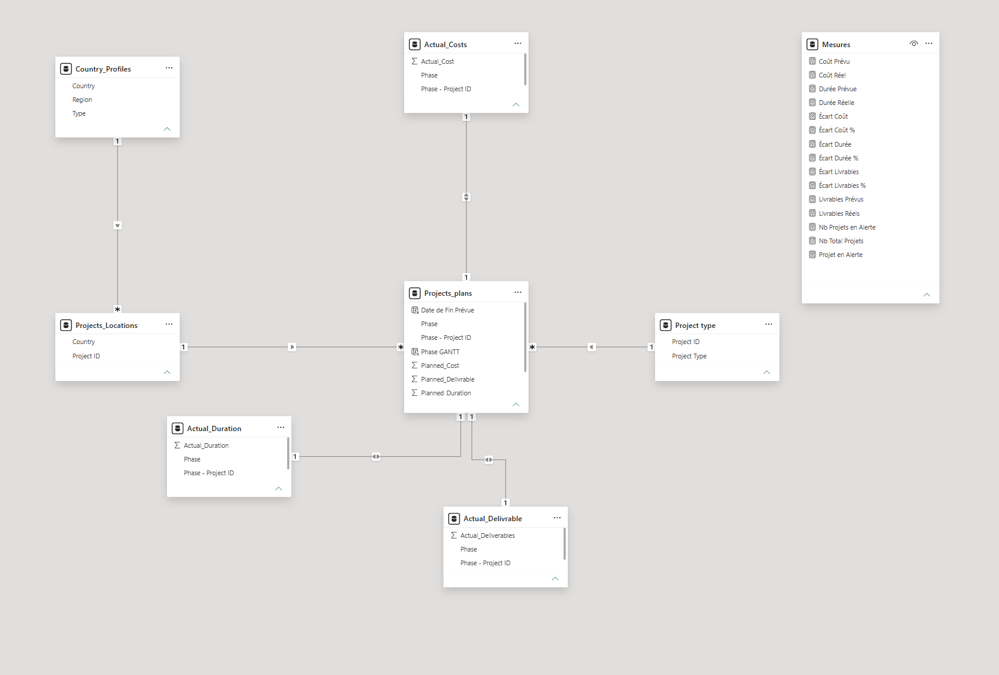

# Global Project Portfolio Monitoring & Variance Analytics (Power BI)

## 📌 Business Overview
This project delivers an interactive executive BI dashboard for **Sanitoral**, an international organization managing cross-border IT and Marketing project portfolios. The objective is to centralize performance tracking, automate data refresh workflows, and provide actionable drill-down capabilities across three leadership tiers (Executive, Regional, Country).

---

## 🎯 Framing & User Stories (Product Strategy Canvas)
Developed using a user-centric framework addressing three distinct management personas:
- **CEO / General Management:** High-level portfolio health, total active vs. delayed projects, overall budget drift, and domain filtering (IT vs. Marketing).
- **Regional Directors:** Geographic map distribution, regional delay bottlenecks, and localized project intervention triggers.
- **Country Managers:** Granular phase-level tracking (Phases 1–4 for Marketing, Phases A–F for IT), KPI variances, and interactive tooltips for project detail.

---

## ⚙️ Automated ETL Architecture (Power Query)
- **Zero-Manual Preprocessing:** Automated data cleansing and shaping pipeline executed entirely in Power Query M-code.
- **Relational Composite Keys:** Built surrogate unique keys `[Phase - Project ID]` via column mergers to bridge project plans and actual performance records without altering raw files.
- **Weekly Scalability:** Automated transformation steps configured to handle recurring updates with zero data integrity loss.

---

## 🗄️ Data Model & Architecture
Implemented a normalized Star Schema designed for optimal analytical performance and clear filter propagation:
- **Central Plan Fact Table:** `Projects_plans`
- **Fact Tables (Actuals):** `Actual_Costs`, `Actual_Duration`, `Actual_Deliverable`
- **Dimensions:** `Country_Profiles`, `Projects_Locations`, `Project type`
- **Dedicated Measure Table:** `Mesures` (isolating all business calculations)

---

## 📈 DAX Analytics & Governance
- **Variance Analysis:** Dynamic tracking of planned vs. actual metrics across Cost, Duration, and Deliverables.
- **Automated Risk Flags:** Immediate conditional alerts for any project experiencing $\ge 15\%$ drift on deadlines, budgets, or milestones.
- **Custom Visuals & UX:** Integration of custom **Gantt Chart** timeline visual, interactive Q&A natural language querying, and contextual hover tooltips.

---

## 📁 Repository Structure

- `Sanitoral_Project_Monitoring.pbix` : Full interactive Power BI report (embedded model and visuals)
- `project_strategy_canvas.png` : Business requirements and user stories
- `data_model.png` : Star schema relational architecture
- `etl_steps.png` : Automated Power Query ETL pipeline
- `README.md` : Project documentation
