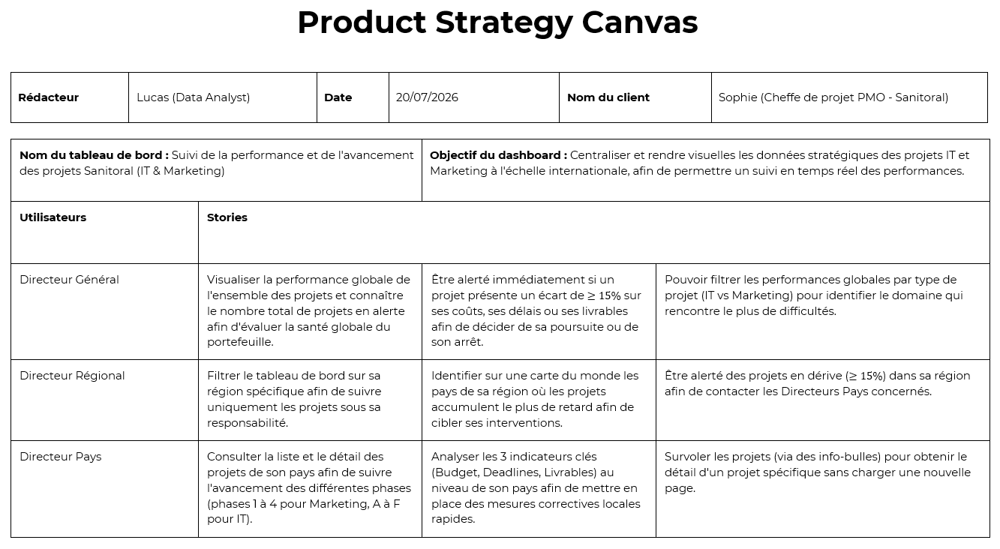
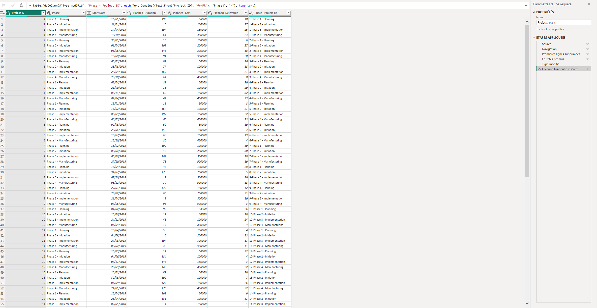
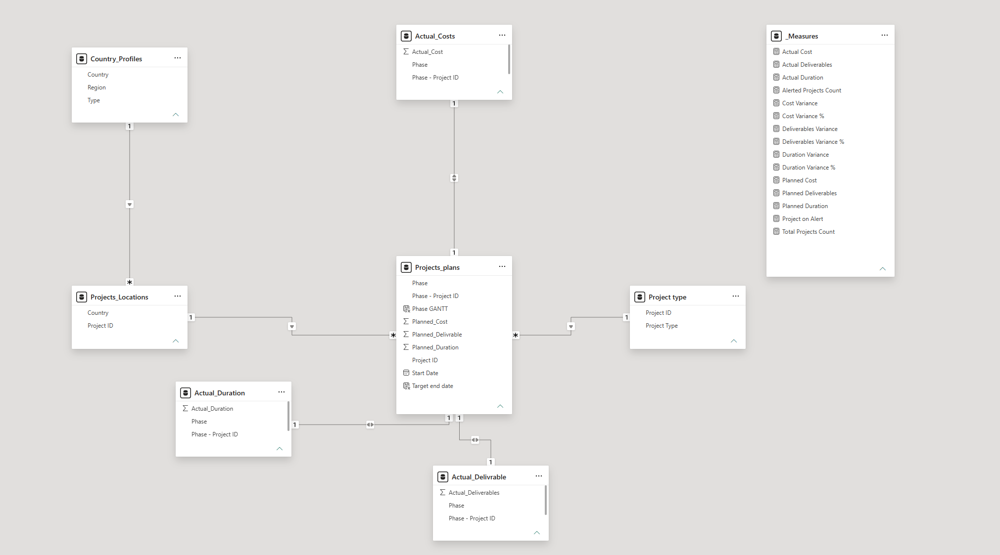

**Français** | [English](README.en.md)

# Suivi d'un portefeuille de projets et analyse des écarts (Power BI)

## En bref

Tableau de bord Power BI interactif pour Sanitoral, une organisation internationale qui gère en parallèle des projets informatiques et marketing dans plusieurs pays. L'objectif : centraliser le suivi de la performance, automatiser l'actualisation des données et permettre d'explorer les résultats à trois niveaux de direction (général, régional, pays).

- **Outils :** Power BI, Power Query (M), DAX
- **Livrables :** rapport Power BI, modèle de données en étoile, mesures DAX documentées

> Le rapport et ses captures sont en anglais.

---

## Cadrage et besoins utilisateurs

Le tableau de bord a été cadré à partir des besoins de trois profils de décideurs :
- **Direction générale :** santé globale du portefeuille, projets actifs et en retard, dérive budgétaire globale, filtre par domaine (informatique ou marketing).
- **Directeurs régionaux :** répartition géographique sur carte, zones où les retards s'accumulent, déclencheurs d'intervention locale.
- **Responsables pays :** suivi détaillé par phase (phases 1 à 4 pour le marketing, A à F pour l'informatique), écarts sur les indicateurs clés, infobulles interactives sur chaque projet.

---

## Préparation des données automatisée (Power Query)

- **Aucun retraitement manuel :** nettoyage et mise en forme entièrement réalisés en langage M dans Power Query.
- **Clés composites :** création d'une clé unique `[Phase - Project ID]` par fusion de colonnes, pour relier les plans de référence aux réalisations sans modifier les fichiers sources.
- **Actualisation reproductible :** les étapes de transformation absorbent les mises à jour récurrentes sans perte d'intégrité.

---

## Modèle de données

Modèle en étoile, conçu pour des calculs performants et une propagation claire des filtres :
- **Table de faits centrale (prévisionnel) :** `Projects_plans`
- **Tables de faits (réalisé) :** `Actual_Costs`, `Actual_Duration`, `Actual_Deliverable`
- **Tables de dimensions :** `Country_Profiles`, `Projects_Locations`, `Project type`
- **Table de mesures dédiée :** `_Measures`, qui regroupe tous les calculs DAX

---

## Mesures DAX et pilotage

Toutes les mesures sont regroupées et documentées dans [`dax_measures.md`](./dax_measures.md).

- **Suivi des écarts :** prévu contre réalisé sur les coûts, les durées et les livrables, en valeur et en pourcentage.
- **Alertes automatiques :** un projet est signalé dès qu'il dérive d'au moins 15 % sur son budget, ses délais ou ses livrables.
- **Expérience utilisateur :** diagramme de Gantt personnalisé, questions en langage naturel (Q&A) et infobulles contextuelles.

---

## Contenu du dépôt

| Fichier | Description |
|---|---|
| `Sanitoral-Project_Monitoring_en.pbix` | Rapport Power BI interactif complet |
| `dax_measures.md` | Mesures DAX documentées |
| `project_strategy_canvas.png` | Cadrage : besoins et récits utilisateurs |
| `data_model_en.png` | Modèle de données en étoile |
| `etl_steps.png` | Étapes de préparation dans Power Query |
| `README.md` / `README.en.md` | Documentation en français / en anglais |

---

Projet réalisé dans le cadre de la formation Data Analyst d'OpenClassrooms.
